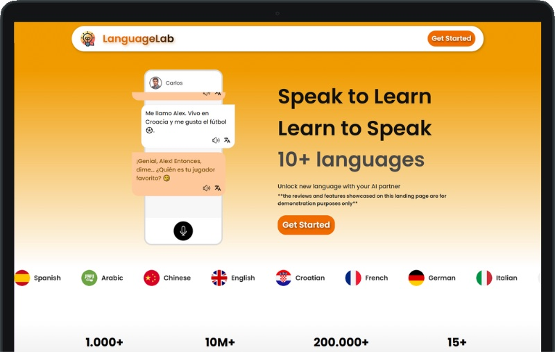

# Language Lab

An AI language tutor you talk to: speech in, speech out, with progress tracking.
Practising a language out loud usually needs another person. This one needs a microphone.

**Live:** [language1ab.netlify.app](https://language1ab.netlify.app)



## What it does

- **Five practice modes:** open chat, guided dialogues, roleplay of real situations, debates, and scenarios such as shopping or travelling
- **Voice both ways:** speech recognition for what you say, speech synthesis for the tutor's replies
- **Levels A1 to C2** and five languages: English, Spanish, French, German, Italian
- **Progress:** levels, streaks and stats saved per account, plus inline translation when you get stuck

## How it works

- React (Vite) single-page app
- OpenAI generates the tutor's side of the conversation. Calls go through a Netlify serverless function
  (`netlify/functions/chat.js`), so the API key never reaches the browser
- Azure Speech Services for speech-to-text and text-to-speech
- Firebase for accounts and progress
- Hosted on Netlify

## Run it locally

```bash
cp .env.example .env.local   # fill in Firebase, Azure Speech and OpenAI credentials (no quotes)
npm install
netlify dev                  # Vite plus the serverless function; plain `npm run dev` runs without the AI chat
```

The variables are listed in `.env.example`; deployment notes are in `DEPLOYMENT_GUIDE.md`.

## License

[CC BY-NC 4.0](LICENSE): free to use and adapt with attribution, no commercial use without permission.

---

Built by [Elmir Beširović](https://itselmotech.com/elmir).
